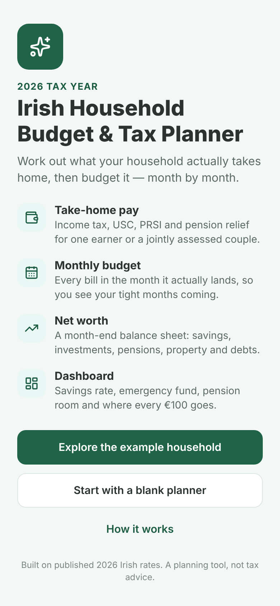
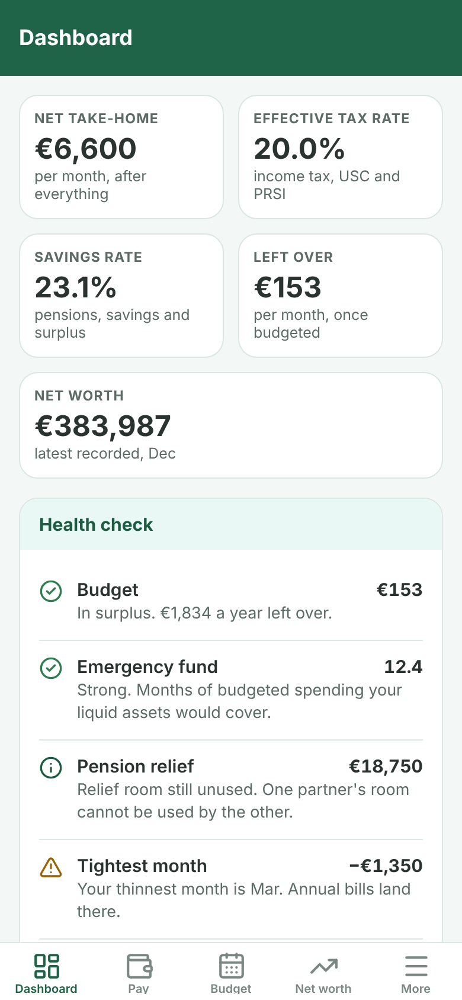
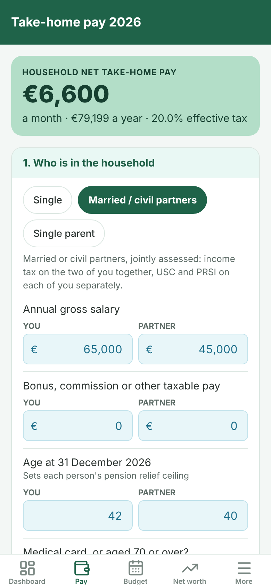
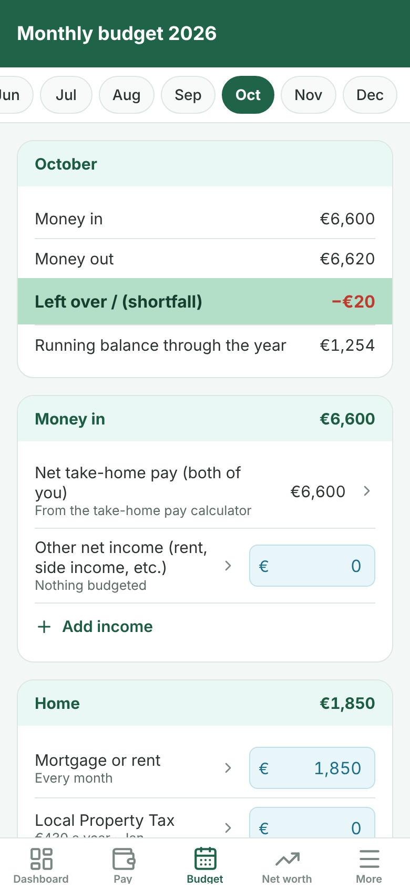
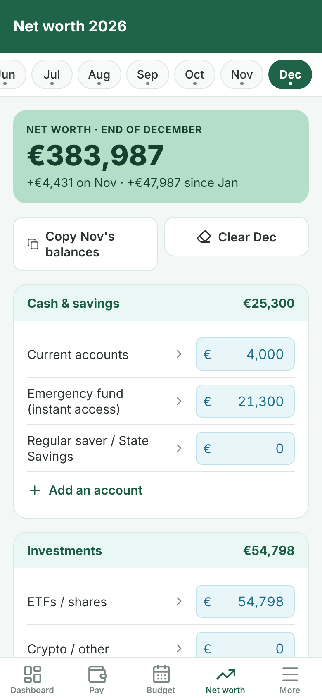

# Irish Household Budget & Tax Planner — Android & iOS app

A phone app version of the **Irish Household Budget & Tax Planner 2026** spreadsheet
(`Irish_Household_Budget_Planner_2026.xlsx`). It does what the workbook does — take-home pay
for one earner or a jointly assessed couple, a month-by-month budget, a net worth balance
sheet, a dashboard and a summary — on the same 2026 Irish rates, with the same results.

Built with [Expo](https://expo.dev) (React Native + TypeScript), so one codebase runs on
Android and iOS.

| Welcome | Dashboard | Take-home pay | Monthly budget | Net worth |
| --- | --- | --- | --- | --- |
|  |  |  |  |  |

## How the sheets map to the app

| Workbook sheet | In the app |
| --- | --- |
| Start Here | Welcome screen (example household or blank start) and **More → How it works** |
| Take-Home Pay | **Pay** tab: income tax (joint assessment), USC and PRSI per person, pension relief check, band and credit overrides, marginal rates, what €100 into a pension really costs |
| Monthly Budget | **Budget** tab: every line month by month, annual bills in the month they land, year totals, monthly averages, % of money in, left over and running balance. Tap a line to edit all 12 months, rename or delete it; add your own lines |
| Net Worth | **Net worth** tab: month-end balances, *copy last month's balances*, totals, liquid assets, months of spending covered, equity in your home, share locked in pensions |
| Dashboard | **Dashboard** tab: the five headline figures, the health check, the three charts and spending by category |
| Summary | **More → Summary** |
| Tax Tables 2026 | **More → Tax tables**: every rate, band and limit is editable, with *Reset to the 2026 rates* |

Figures are saved on the device only. **More → Back up & restore** shares a backup through the
phone's share sheet and restores it by pasting it back in.

## Try it on an Android phone (no computer needed)

1. On GitHub, open **Actions → Android test APK**. Use the latest successful run, or press
   **Run workflow** to build the current code (about 12 minutes).
2. Download **budget-planner-android-apk** from the run's *Artifacts* section and unzip it.
3. Open `app-release.apk` on the phone and allow installing from that source when asked.

This test APK is signed with a development key: it's for trying the app, not for Google Play.

## Run it on your phone with Expo Go (iPhone or Android)

1. Install Node.js 20 or newer.
2. Install the **Expo Go** app on your phone (App Store or Google Play).
3. In this folder:

   ```bash
   npm install
   npx expo start
   ```

4. Scan the QR code — with the Camera app on iPhone, or from inside Expo Go on Android. The
   phone and computer need to be on the same network (or run `npx expo start --tunnel`).

## Build installable apps

Builds run in the cloud with [EAS Build](https://docs.expo.dev/build/introduction/), so no Mac
or Android Studio is needed. You need a free Expo account; iOS builds also need an Apple
Developer Program membership.

```bash
npx eas-cli@latest login
npx eas-cli@latest init                       # first time only: links the project to your Expo account

# Android APK you can install directly on a phone
npx eas-cli@latest build -p android --profile preview

# Store builds (AAB for Google Play, IPA for the App Store)
npx eas-cli@latest build -p android --profile production
npx eas-cli@latest build -p ios --profile production

# Upload to the stores
npx eas-cli@latest submit -p android
npx eas-cli@latest submit -p ios
```

Before the first store submission, check the app name, `ios.bundleIdentifier` and
`android.package` in `app.json` (currently `Budget Planner` and
`com.theirishmoneyguide.budgetplanner`) — the identifiers can't change once an app is published.

## Checks

```bash
npm test            # calculation engine, storage and formatting tests
npm run typecheck
npm run lint
```

The engine tests reproduce the workbook's example household to the cent: €79,199.36 net
take-home (€6,600 a month), €14,900 income tax, €2,365.64 USC, €4,785 PRSI, €77,365 budgeted,
€1,834 left over, 23.1% savings rate, €383,987 net worth, and the Summary's
"every €100" split. The same checks run on GitHub Actions on every push.

## Project layout

```
src/
  engine/      Pure TypeScript port of every formula in the workbook (no React)
    taxTables.ts   Tax Tables 2026 — rates, bands, credits, PRSI, pension limits
    takeHome.ts    Take-Home Pay sheet
    budget.ts      Monthly Budget sheet
    netWorth.ts    Net Worth sheet
    insights.ts    Dashboard and Summary sheets
  data/sample.ts The workbook's example household, and the blank starting point
  store/       Saved state (on-device storage) and backup validation
  app/         Screens (Expo Router: tabs plus the editor, summary and settings screens)
  components/  Inputs, cards, charts
```

To carry the planner into a new tax year, change the defaults in `src/engine/taxTables.ts`
(or edit them in the app under **More → Tax tables**).

## Where the app deliberately differs from the spreadsheet

- **Partner figures count only for married / civil partners.** The workbook says to leave the
  partner column at zero for a single person; the app hides it instead, so a single or
  single-parent status can't pick up a partner's income by accident.
- **A blank net worth month is "not recorded", not €0.** The workbook's dashboard reads
  December; the app uses the latest month you've filled in, and changes are measured from the
  first recorded month. With all twelve months filled in (as in the example) the figures are
  identical. The Summary's "saved vs markets and mortgage" split covers the recorded months only.
- **USC lines show the bands actually charged** when someone is exempt or on the reduced
  medical-card rate. The USC payable is the same as the workbook's.
- **Charts** use one colour for spending categories and a colour-blind-safe pair for money in
  vs money out. Tap a month to see its figures.

Built on published 2026 Irish rates. A planning tool, not tax advice — confirm anything that
matters against [revenue.ie](https://www.revenue.ie) or a qualified adviser.
